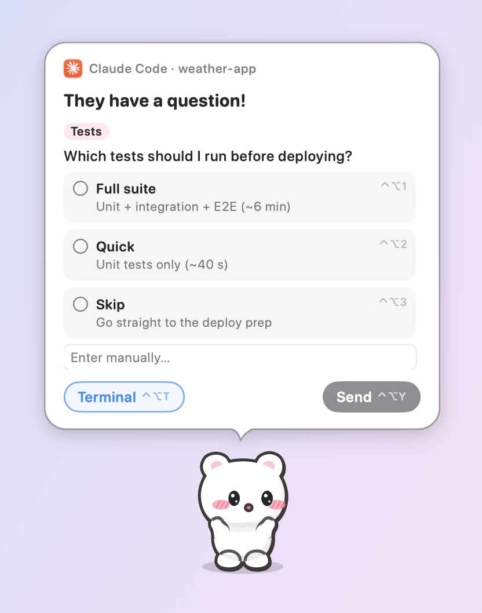
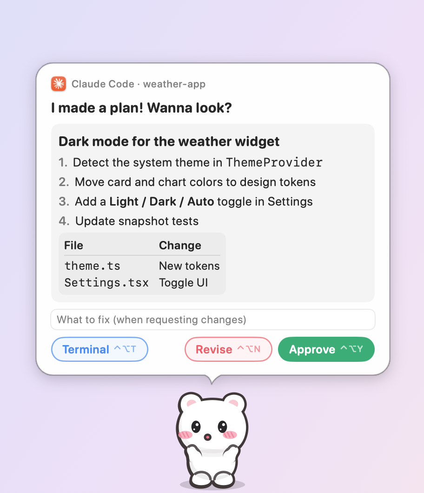
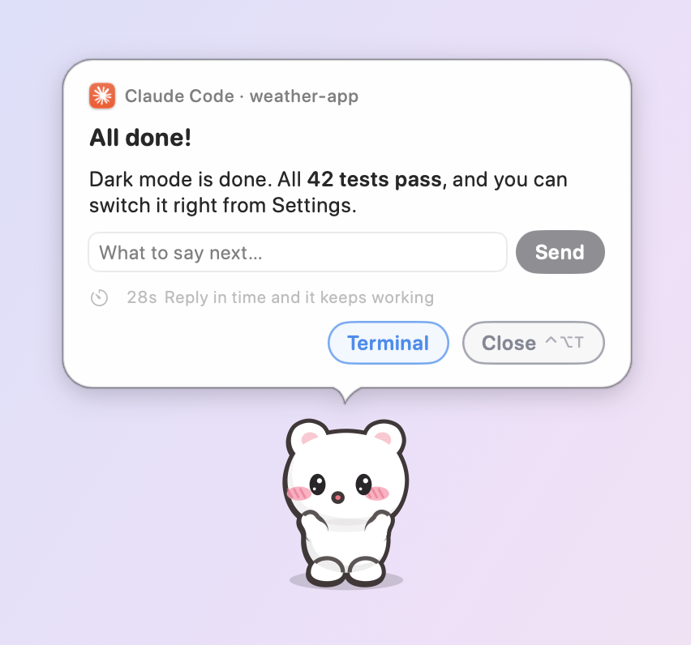
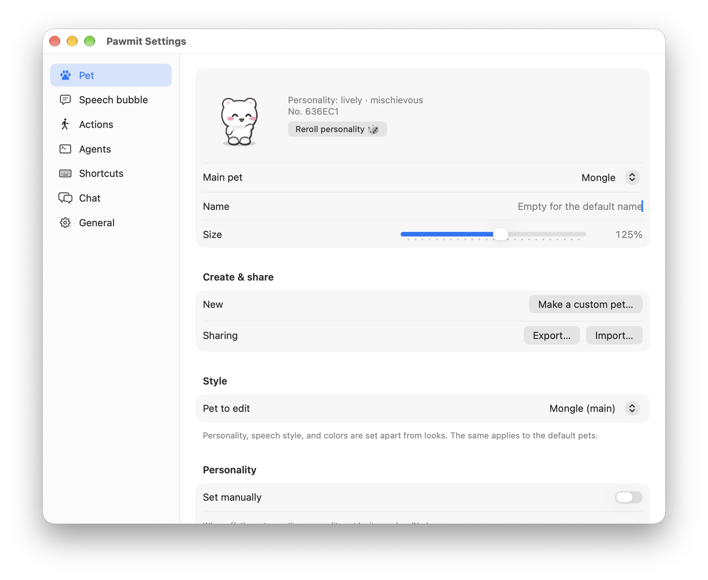
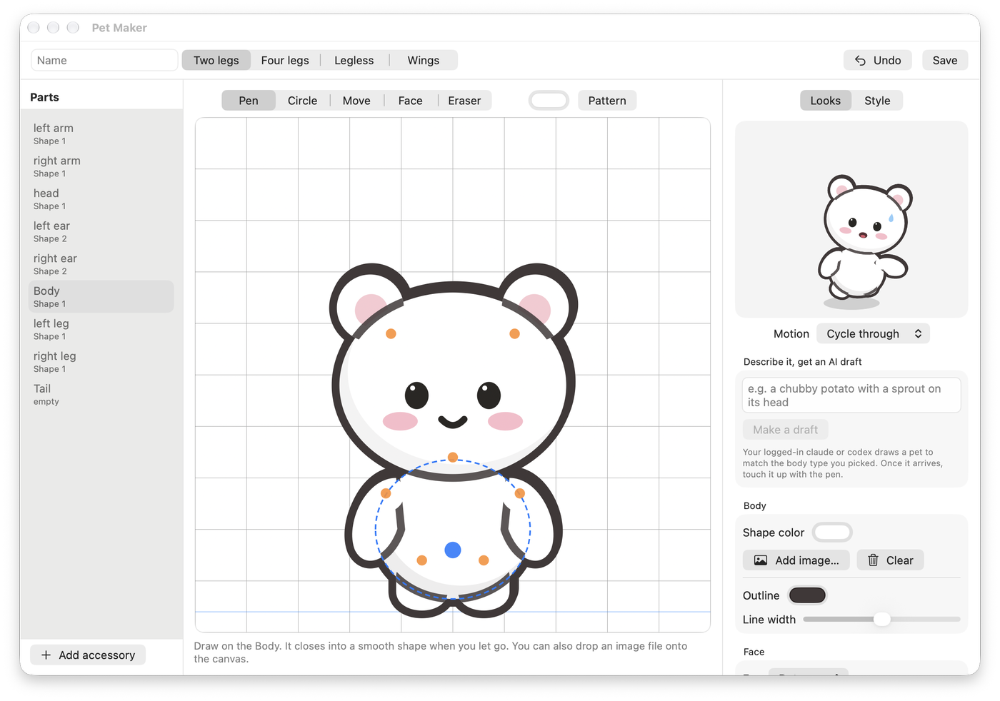

# Pawmit 🐾

[한국어](README.md) · [Sponsor](https://github.com/sponsors/wjchoi87)

A pet living on your macOS screen that takes over your AI coding agents' **approval prompts, questions, and task notifications**.
It wanders around, eats, naps, plays with a ball, digs through the trash, doodles, and cleans up after itself.
When an agent calls, it runs over, asks in a speech bubble, and handles allow / deny / answer / reply right there.

<p align="center"></p>

## What it does

| Area | Details |
|---|---|
| Agent integration | Claude Code, Codex, ZCode(Z.ai), Copilot CLI, Qwen Code, Factory Droid, and Cursor approve/deny right from the pet. Gemini CLI, OpenCode, and Kiro get status and notifications only |
| Speech bubbles | Command approval (full text, risky-command warnings, always allow), AskUserQuestion answers, plan (ExitPlanMode) approve / request changes, and a reply box after each task to keep it going (clicking the box pauses the wait timer). Markdown bodies (headings, lists, code, tables), separate fonts and sizes for hook alerts and chat, the name the pet calls you (leave empty for a default) |
| Pets | Six built-in pets (Mongle, Banban, Tokki, Nalda, Bamtol, Haedal) + a four-legged cat (Cheese) + your own pets made with **Pet Maker** + image and Codex pets. Personality, speech style, and colors are styles; share pets as `.pawmitpet` files |
| Behavior | A personality picked at birth — 8 kinds (lively, curious, sweet, artistic, mischievous, gluttonous, laid-back, tidy) — changes movement, gait, actions, moods, and lines |
| Doodles | 31 line designs (rose curves, spirographs, flowers, houses, lettering) + 12 picture designs (Starry Night, Sunflowers, Mondrian, water lilies, a cherry tree, a lighthouse — famous paintings and manga-style scenery) × 5 palettes. Fade out for up to 60 seconds, then erase themselves. Tidy pets mop them up; right-click or the menu bar to erase |
| Menu bar home | Say "go home" and it walks into its house in the menu bar. Comes back out when called |
| Crossing monitors | Finds the touching edge in your display layout and crosses over. Different floor heights get ladders, ropes, jumps, and umbrellas; friends pull you up or catch you below |
| Friends | Up to 4. Greetings, tag, dancing together, ball passes, napping side by side, high-fives, sharing snacks |
| Chat | Click a pet to chat. Signed-in CLIs (Claude Code, Codex, Gemini) or APIs (Anthropic, OpenAI, Gemini, xAI, DeepSeek, Mistral, Z.ai, Moonshot, Qwen, Groq, OpenRouter, Ollama, LM Studio), or a custom provider. Model lists load automatically. History is saved to disk and survives restarts |
| System stats | CPU↑ makes it hot, RAM↑ sluggish, disk↑ chubby (can be disabled). Occasionally reports via a thermometer (℃), speedometer (km/h), or scale (GB) |

## Preview

<p align="center"></p>

| Answer questions | Approve plans |
|---|---|
|  |  |
| **Reply when a task ends** | **Built-in pets** |
|  |  |
| **Settings** | **Pet Maker** |
|  |  |

## Install

Requires macOS 14 or later.

### Download

1. Grab `Pawmit-<version>.zip` from [Releases](https://github.com/wjchoi87/Pawmit/releases/latest).
2. Unzip it and move `Pawmit.app` into `/Applications` so "launch at login" works reliably.
3. The app is not notarized by Apple, so macOS blocks the first launch. Click "Open Anyway" in **System Settings → Privacy & Security**, or run this once in Terminal:

```bash
xattr -dr com.apple.quarantine /Applications/Pawmit.app
```

### Build from source

Requires Swift 6 (Xcode or Command Line Tools).

```bash
./scripts/build-app.sh
open build/Pawmit.app
```

The first launch installs the `~/.pawmit/bin/pawmit` CLI. All data lives in `~/.pawmit/`.

## Connecting agents

Menu bar house → **Settings… → Agents**, click "Connect": it shows what will change, backs the originals up to `~/.pawmit/backups/`, then adds hooks to each agent's config file. Other hooks are left untouched. You can also do it from the terminal (see CLI below).

| Agent | Config file | What the pet can do |
|---|---|---|
| Claude Code | `~/.claude/settings.json` | Approve/deny/always allow, answer questions, approve plans, reply after tasks |
| Codex | `~/.codex/hooks.json` | Approve/deny, reply after tasks (run `/hooks` in Codex once to trust them) |
| Copilot CLI | `~/.copilot/hooks/pawmit.json` | Approve/deny |
| Qwen Code | `~/.qwen/settings.json` | Approve/deny, reply after tasks |
| Factory Droid | `~/.factory/hooks.json` | Approve/deny the tools you choose, reply after tasks |
| Cursor | `~/.cursor/hooks.json` | Reply after tasks, shell/MCP command approval (if configured) |
| Gemini CLI | `~/.gemini/settings.json` | Status and notifications |
| OpenCode | `~/.config/opencode/plugins/pawmit.js` | Status and notifications |
| ZCode (Z.ai) | `~/.zcode/cli/config.json` (`hooks.events`, process hook) | Approve/deny/always allow, reply after tasks (takes effect after a ZCode restart) |
| Kiro CLI | Add to the agent config yourself (instructions provided) | Status |

If the app is closed or the wait timer expires, the hook prints nothing and you fall through to your **normal terminal prompt**.
Answering in the terminal first closes the speech bubble automatically.
The bubble's **Terminal** button (⌃⌥T) jumps to that session: tmux panes, iTerm2 sessions, Terminal.app tabs, kitty windows.
Sessions running inside the Claude desktop app (Code tab) or the Codex app open that very conversation; other terminals and apps just bring the app to the front.

## CLI

The `~/.pawmit/bin/pawmit` CLI does the same from the terminal. `pawmit help` lists every command, `pawmit pet help` the pet ones.

```bash
pawmit status                          # connection status
pawmit install claude codex --dry-run  # connect (preview changes first)
pawmit uninstall codex                 # disconnect
pawmit notify --title "Build" "Deploy finished"  # notification card
pawmit say "Great work today!"  # pet says it in a speech bubble
pawmit pet list                        # built-in and custom pets
pawmit pet use sprout-potato  # set as the main pet
```

## Shortcuts

Only while a speech bubble is up (change them in Settings → Shortcuts).

| Key | Action |
|---|---|
| ⌃⌥Y | Allow · send · approve plan |
| ⌃⌥N | Deny · request changes |
| ⌃⌥A | Always allow |
| ⌃⌥T | Send to terminal · close |
| ⌃⌥1~9 | Pick a question option |
| ⌃⌥P | Open bubble / chat with the pet (always) |

## Pet Maker — build your own pet

Menu bar house → **Make a custom pet… → Pet Maker**. Creates a brand-new pet, independent of the built-ins.

- Pick a body plan (biped · quadruped · legless · winged) and thousands of actions, expressions, and monitor-crossing come along automatically
- Draw with the pen (jitter correction), drop in per-part image files, or **describe it and let AI draft it** ("a chubby potato with a sprout on its head")
- Watch it walk, eat, and sleep in the live preview; save it as your main pet or a friend, or export it as `.pawmitpet`
- Personality, speech style (verbal tics, endings, emoji, chattiness, chat tone), and colors are set separately as **styles**, and they apply to built-in pets too (Settings → Pet → Style)

## Other custom pets

Menu bar house → **Make a custom pet…**

1. **Assemble**: pick ears, tail, pattern, colors, and head size with a live preview. "Start from a built-in pet" builds on top of one. Saves a `pet.json` (`"kind": "chibi"`)
2. **Your art**: drag in per-state images (GIF, PNG, APNG, WebP). Even a single idle frame gets a waddling walk, bouncing, and similar motion automatically
3. **Edit an existing pet**: pick an image pet you made, drop in new art or remove it with ✕, and save over the same folder. The running pet reloads immediately

Codex pets in `~/.codex/pets` show up in the list right away.
To make one yourself, put files named for their states in `~/.pawmit/pets/<folder>/` — `idle.gif`, `walk.gif`, `sleep.png`.
Usable states: idle, sit, walk, run, sleep, eat, dig, draw, play, pounce, alert, happy, sad, groom, think, drag, fall, wave (missing states fall back to similar ones).

You can also create and edit pets from the terminal. The full format lives in [docs/PET_FORMAT.md](docs/PET_FORMAT.md).

```bash
pawmit pet new "sprout-potato" --skeleton biped
```

```bash
pawmit pet preview sprout-potato
```

### Sharing and backing up pets

Settings → Pet → **This pet only…** makes a `.pawmitpet` file; the recipient double-clicks it (or uses **Import…**) to bring the pet home.
**Export all…** backs up every custom pet and your pet settings (built-in styles, cat coat, main pet, friends) in one file. Importing it on another Mac restores the pets and settings, skipping pets you already have.
Imports show their contents for confirmation first, and accept nothing but art and pet.json.

```bash
pawmit pet export mint-bunny -o mint-bunny.pawmitpet
pawmit pet export --all -o pawmit-pets.pawmitpet   # full backup
```

```bash
pawmit pet import mint-bunny.pawmitpet
pawmit pet use mint-bunny     # set as the main pet
```

## Settings

Menu bar house → **Settings…**: pet, friends, size, style (personality, speech, colors), reroll personality / font size and family / movement range, speed, performance (smooth · balanced · battery), doodles, system stats / agent connections, do-not-disturb, reply wait time / shortcuts / chat AI and model / language (한국어 · English, applies instantly) / launch at login.
Everything also lives in `~/.pawmit/config.json`, and edits to the file apply immediately. Doodles can also be erased all at once with **Erase all doodles** in the menu bar house menu.

### Updates

Put an `update.json` URL in Settings → General → Update and it checks weekly, announces new versions as a speech-bubble card, and downloads, installs, and restarts on click. Manual check via Menu → **Check for Updates…**.

### Chat AI

Settings → Chat: pick a provider and its model list loads automatically (manual entry works too).

| Kind | Providers | What you need |
|---|---|---|
| Signed-in CLI | Claude Code CLI · Codex CLI · Gemini CLI | Log in to each CLI |
| API | Anthropic · OpenAI (Responses) · Google Gemini · xAI · DeepSeek · Mistral · Z.ai · Moonshot · Qwen (DashScope) · Groq · OpenRouter | API key |
| Local | Ollama · LM Studio | A running local server |
| Custom | Any endpoint speaking Anthropic Messages / OpenAI-compatible Chat Completions / OpenAI Responses | URL (+key) |

API keys live only in the **macOS keychain**, never in settings files. If you don't pick a model, a fast one (haiku, mini, flash, …) is chosen automatically.

## Security

- Commands are shown in full, untruncated, with warnings on hard-to-reverse ones. Enter does not approve.
- Chat API keys live only in the **macOS keychain**, never in settings files.

## Known limitations

- **Chatting via Claude Code** requires a standalone `claude` CLI to be logged in (`claude` then `/login`). Otherwise chat falls back to Codex automatically.
- `codex exec` (non-interactive) never elevates permissions, so approval hooks can't be tested there. Interactive Codex works.
- Finding the Dock trash location needs the Accessibility permission; without it, a Pawmit trash prop sits in a screen corner.
- Hovering briefly over a doodle gives it the right-click menu, so that doodle takes the click. Left-click and it lets clicks pass through again for 2 seconds.

See [THIRD_PARTY_NOTICES.md](THIRD_PARTY_NOTICES.md) for bundled open source and licenses.
