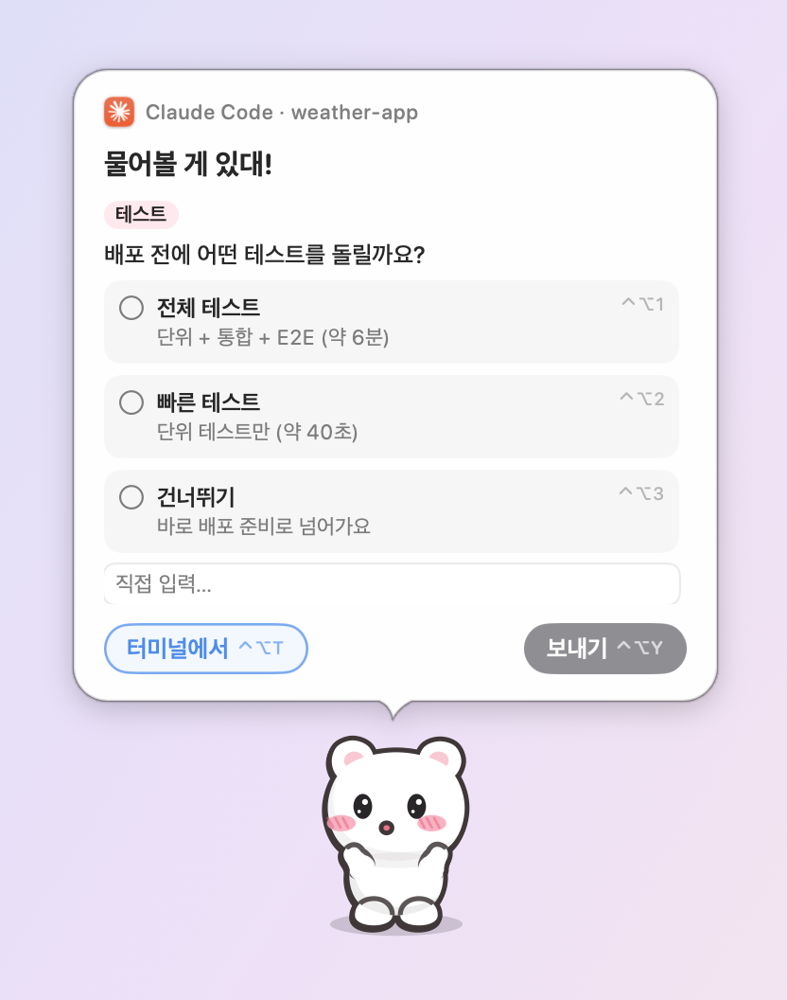
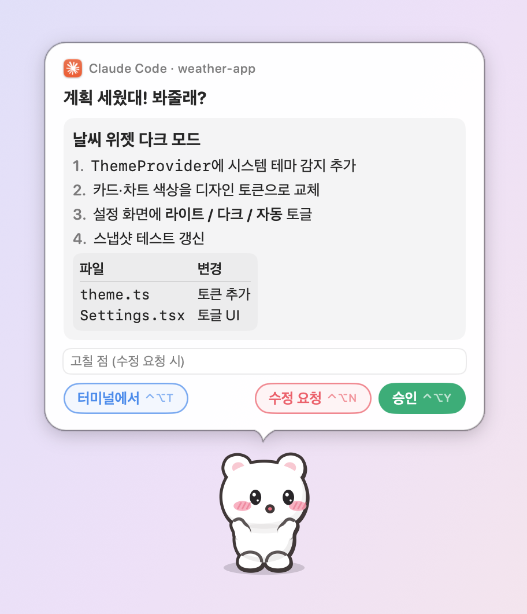
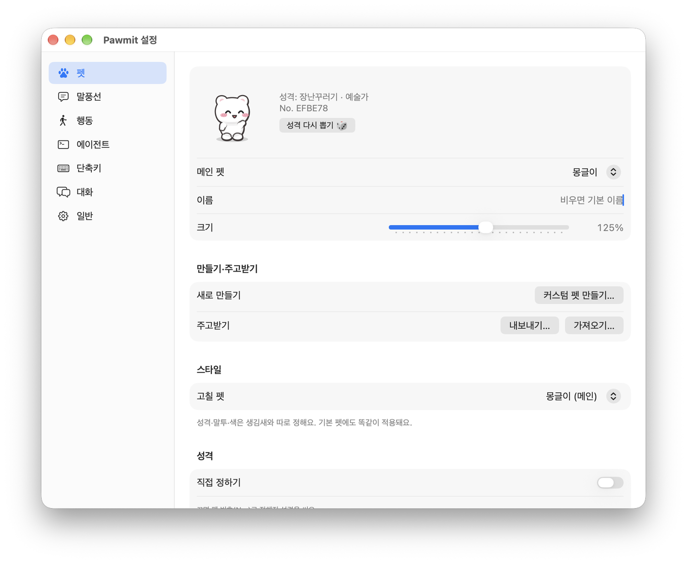
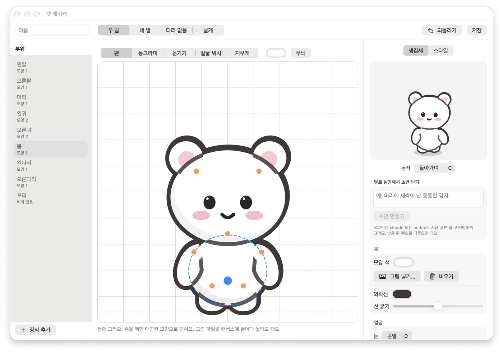

# Pawmit 🐾

[English](README.en.md) · [스폰서](https://github.com/sponsors/wjchoi87)

macOS 데스크탑에 사는 펫이 **AI 코딩 에이전트의 승인·질문·작업 완료 알림**을 대신 받아 주는 앱입니다.
펫은 화면 전체를 돌아다니며 밥 먹고, 낮잠 자고, 공놀이하고, 휴지통을 뒤지고, 낙서하고 청소합니다.
에이전트가 부르면 달려와서 말풍선으로 묻고, 그 자리에서 허용·거절·답변·답장까지 합니다.

<p align="center"></p>

## 무엇을 하나

| 영역 | 내용 |
|---|---|
| 에이전트 연동 | Claude Code, Codex, ZCode(Z.ai), Copilot CLI, Qwen Code, Factory Droid, Cursor도 펫에서 승인·거절. Gemini CLI·OpenCode·Kiro는 상태·알림만 |
| 말풍선 | 명령 승인(전문 표시·위험 경고·항상 허용), AskUserQuestion 답변, 계획(ExitPlanMode) 승인·수정 요청, 작업 끝나면 답장으로 이어서 시키기(입력칸을 누르면 대기 시간 멈춤). 본문 마크다운(제목·목록·코드·표), hook 알림·대화 글꼴·크기 따로 설정, 펫이 부르는 내 호칭(비우면 ‘사용자’) |
| 펫 | 기본 펫 6종(몽글이·반반이·토깽이·날다람·밤톨이·해달이) + 사족 고양이 + **펫 메이커**로 만든 나만의 펫 + 그림·Codex 펫. 성격·말투·색은 스타일로 정하고, `.pawmitpet` 파일로 주고받기 |
| 행동 | 태어날 때 정해지는 성격 8가지(활발·호기심·다정·예술·장난·식탐·느긋·깔끔)에 따라 이동 패턴·걸음걸이·동작·감정·대사가 달라짐 |
| 낙서 | 선 도안 31종(장미곡선·스피로그래프·꽃·집·글씨) + 그림 도안 12종(별이 빛나는 밤·해바라기·몬드리안·수련·벚꽃 나무·등대 등 명화와 만화 풍경) × 팔레트 5벌. 최대 60초 동안 점점 흐려지다가 저절로 지워짐. 깔끔한 펫은 물걸레로 청소, 우클릭·메뉴바로 지우기 |
| 메뉴바 집 | "집에 가" 하면 메뉴바 집으로 걸어 들어감. 부르면 나옴 |
| 모니터 건너기 | 디스플레이 배치에서 맞닿은 변을 찾아 건너감. 바닥 높이가 다르면 사다리·밧줄·점프·우산으로 오르내리고, 친구가 있으면 위에서 끌어올려 주거나 아래에서 받아 줌 |
| 친구 | 최대 4마리. 인사·술래잡기·같이 춤·공 주고받기·나란히 낮잠·하이파이브·간식 나눠먹기 |
| 대화 | 펫을 클릭해서 수다. 로그인한 CLI(Claude Code·Codex·Gemini), API(Anthropic·OpenAI·Gemini·xAI·DeepSeek·Mistral·Z.ai·Moonshot·Qwen·Groq·OpenRouter·Ollama·LM Studio), 커스텀 제공자. 모델 목록 자동 불러오기. 기록은 디스크에 저장돼 앱을 껐다 켜도 이어짐 |
| 시스템 상태 | CPU↑ 더워함, RAM↑ 느려짐, 디스크↑ 통통해짐(끌 수 있음). 가끔 온도계(℃)·시속(km/h)·체중계(GB)로 알려줌 |

## 미리보기

<p align="center"></p>

| 질문에 답하기 | 계획 승인 |
|---|---|
|  |  |
| **작업 끝나면 답장** | **기본 펫** |
|  |  |
| **설정** | **펫 메이커** |
|  |  |

## 설치

요구 사항: macOS 14 이상

### 다운로드

1. [Releases](https://github.com/wjchoi87/Pawmit/releases/latest)에서 `Pawmit-<버전>.zip`을 받습니다.
2. 압축을 풀고 `Pawmit.app`을 `/Applications`로 옮깁니다. 그래야 "로그인 시 실행"이 안정적으로 동작합니다.
3. Apple 공증을 받지 않은 앱이라 처음 열 때 macOS가 막습니다. **시스템 설정 → 개인정보 보호 및 보안**에서 "그래도 열기"를 누르거나, 터미널에서 아래 명령을 한 번 실행하세요.

```bash
xattr -dr com.apple.quarantine /Applications/Pawmit.app
```

### 소스에서 빌드

Swift 6(Xcode 또는 Command Line Tools)이 필요합니다.

```bash
./scripts/build-app.sh
open build/Pawmit.app
```

처음 실행하면 `~/.pawmit/bin/pawmit` CLI가 설치됩니다. 모든 데이터는 `~/.pawmit/` 에 있습니다.

## 에이전트 연결

메뉴바 집 → **설정… → 에이전트** 탭에서 "연결"을 누르면, 바꿀 내용을 보여주고 원본을 `~/.pawmit/backups/`에 백업한 뒤
각 에이전트 설정 파일에 hook을 추가합니다. 다른 hook은 건드리지 않습니다. 터미널로도 할 수 있습니다(아래 CLI).

| 에이전트 | 설정 파일 | 펫에서 할 수 있는 것 |
|---|---|---|
| Claude Code | `~/.claude/settings.json` | 승인·거절·항상 허용, 질문 답변, 계획 승인, 작업 끝 답장 |
| Codex | `~/.codex/hooks.json` | 승인·거절, 작업 끝 답장(연결 후 Codex에서 `/hooks`로 trust 필요) |
| Copilot CLI | `~/.copilot/hooks/pawmit.json` | 승인·거절 |
| Qwen Code | `~/.qwen/settings.json` | 승인·거절, 작업 끝 답장 |
| Factory Droid | `~/.factory/hooks.json` | 지정한 도구 승인·거절, 작업 끝 답장 |
| Cursor | `~/.cursor/hooks.json` | 작업 끝 답장, 셸·MCP 명령 승인(설정 시) |
| Gemini CLI | `~/.gemini/settings.json` | 상태·알림 |
| OpenCode | `~/.config/opencode/plugins/pawmit.js` | 상태·알림 |
| ZCode(Z.ai) | `~/.zcode/cli/config.json`(`hooks.events`, process hook) | 승인·거절·항상 허용, 작업 끝 답장(ZCode 재시작 후 적용) |
| Kiro CLI | 에이전트 설정에 직접 추가(안내 문구 제공) | 상태 |

앱이 꺼져 있거나 대기 시간이 지나면 hook은 아무것도 출력하지 않고 끝나서 **원래 터미널 프롬프트**로 넘어갑니다.
터미널에서 먼저 답하면 말풍선은 자동으로 닫힙니다.
말풍선의 **터미널** 버튼(⌃⌥T)은 그 세션으로 이동합니다: tmux pane · iTerm2 세션 · Terminal.app 탭 · kitty 창.
Claude 데스크탑 앱(Code 탭)과 Codex 앱 안에서 도는 세션은 그 앱의 대화를 바로 열고, 그 외 터미널·앱은 앱만 앞으로 가져옵니다.

## CLI

`~/.pawmit/bin/pawmit` CLI로 터미널에서도 같은 일을 할 수 있습니다. 전체 명령은 `pawmit help`, 펫 명령은 `pawmit pet help`로 봅니다.

```bash
pawmit status                          # 연결 상태
pawmit install claude codex --dry-run  # 연결 (바꿀 내용 미리 보기)
pawmit uninstall codex                 # 연결 해제
pawmit notify --title "빌드" "배포 끝났어"  # 펫에게 알림 카드
pawmit say "오늘도 수고했어!"  # 펫이 말풍선으로 말하기
pawmit pet list                        # 기본·커스텀 펫 목록
pawmit pet use 새싹감자  # 메인 펫으로 쓰기
```

## 단축키

말풍선이 떠 있을 때만 잡습니다(설정 → 단축키에서 변경).

| 키 | 동작 |
|---|---|
| ⌃⌥Y | 허용 · 보내기 · 계획 승인 |
| ⌃⌥N | 거절 · 수정 요청 |
| ⌃⌥A | 항상 허용 |
| ⌃⌥T | 터미널로 넘기기 · 닫기 |
| ⌃⌥1~9 | 질문 선택지 고르기 |
| ⌃⌥P | 말풍선 열기 / 펫과 대화(항상) |

## 펫 메이커 — 나만의 펫 만들기

메뉴바 집 → **커스텀 펫 만들기… → 펫 메이커**. 기본 펫과 상관없이 완전히 새로운 생김새의 펫을 만듭니다.

- 몸 구조(두 발 · 네 발 · 다리 없음 · 날개)를 고르면 행동 수천 가지와 표정, 모니터 건너기가 자동으로 붙습니다
- 펜으로 직접 그리기(손떨림 보정), 부위별 그림 파일 넣기, **말로 설명하면 AI가 초안**("머리에 새싹이 난 통통한 감자")
- 실시간 미리보기로 걷기·먹기·잠을 보며 다듬고, 저장하면 바로 메인 펫·친구로 데려가거나 `.pawmitpet`으로 내보낼 수 있습니다
- 성격·말투(말버릇·말끝·이모지·수다 정도·대화 말투)·색은 **스타일**로 따로 정하며, 기본 펫에도 똑같이 적용됩니다(설정 → 펫 → 스타일)

## 기타 커스텀 펫

메뉴바 집 → **커스텀 펫 만들기…**

1. **조립**: 귀·꼬리·무늬·색·머리 크기를 고르면 실시간 미리보기. "기본 펫에서 시작"으로 기본 펫을 바탕 삼아 고칠 수도 있습니다. `pet.json`(`"kind": "chibi"`)으로 저장
2. **내 그림**: 상태별 이미지(GIF·PNG·APNG·WebP)를 끌어다 놓기. 가만히(idle) 한 장만 있어도 걷기 뒤뚱·통통 같은 모션이 자동으로 붙습니다
3. **기존 펫 고치기**: 만든 이미지 펫을 골라 그림을 새로 끌어다 놓아 교체하거나 ✕로 빼고, 같은 폴더에 덮어 저장합니다. 저장하면 실행 중인 펫도 바로 다시 불러옵니다

`~/.codex/pets`에 있는 Codex 펫은 목록에 바로 나옵니다.
직접 만들 때는 `~/.pawmit/pets/<폴더>/` 에 `idle.gif`, `walk.gif`, `sleep.png`처럼 상태 이름으로 넣으면 됩니다.
쓸 수 있는 상태: idle, sit, walk, run, sleep, eat, dig, draw, play, pounce, alert, happy, sad, groom, think, drag, fall, wave(없으면 비슷한 상태로 대체).

터미널에서도 만들고 고칠 수 있습니다. 형식 전체는 [docs/PET_FORMAT.md](docs/PET_FORMAT.md).

```bash
pawmit pet new "새싹감자" --skeleton biped
```

```bash
pawmit pet preview 새싹감자
```

### 펫 주고받기·백업

설정 → 펫 → **지금 펫만…** 으로 `.pawmitpet` 파일을 만들어 건네면, 받은 사람은 파일을 더블클릭(또는 **가져오기…**)해서 데려옵니다.
**모두 내보내기…** 는 커스텀 펫 전부와 펫 설정(기본 펫 스타일·고양이 털색·메인 펫·친구)을 파일 하나로 백업합니다. 다른 Mac에서 가져오면 펫과 설정을 그대로 되돌릴 수 있고, 이미 있는 똑같은 펫은 건너뜁니다.
가져올 때 내용을 먼저 보여주고 확인을 받으며, 그림·pet.json 외의 파일은 받지 않습니다.

```bash
pawmit pet export mint-bunny -o mint-bunny.pawmitpet
pawmit pet export --all -o pawmit-pets.pawmitpet   # 전체 백업
```

```bash
pawmit pet import mint-bunny.pawmitpet
pawmit pet use mint-bunny     # 메인 펫으로
```

## 설정

메뉴바 집 → **설정…**: 펫·친구·크기·스타일(성격·말투·색)·성격 다시 뽑기 / 글씨 크기·글꼴 / 이동 범위·속도·성능(부드럽게·균형·절전)·낙서·시스템 상태 반영 / 에이전트 연결·방해 금지·답장 대기 시간 / 단축키 / 대화 AI·모델 / 언어(한국어·English, 바꾸면 바로 적용) / 로그인 시 실행.
모든 값은 `~/.pawmit/config.json` 에도 있고, 파일을 고치면 바로 반영됩니다. 낙서는 메뉴바 집 메뉴의 **낙서 모두 지우기**로도 한 번에 지울 수 있습니다.

### 업데이트

설정 → 일반 → 업데이트에 `update.json` 주소를 넣으면 주 1회 새 버전을 확인해 말풍선 카드로 알려 주고, 누르면 내려받아 설치하고 재시작합니다. 메뉴 → **업데이트 확인…** 으로 수동 확인도 가능합니다.

### 대화 AI

설정 → 대화에서 제공자를 고르면 그 제공자의 모델 목록을 자동으로 불러옵니다(직접 입력도 가능).

| 종류 | 제공자 | 필요한 것 |
|---|---|---|
| 로그인한 CLI | Claude Code CLI · Codex CLI · Gemini CLI | 각 CLI에 로그인 |
| API | Anthropic · OpenAI(Responses) · Google Gemini · xAI · DeepSeek · Mistral · Z.ai · Moonshot · Qwen(DashScope) · Groq · OpenRouter | API 키 |
| 내 컴퓨터 | Ollama · LM Studio | 실행 중인 로컬 서버 |
| 커스텀 | Anthropic Messages / OpenAI 호환 Chat Completions / OpenAI Responses 방식의 아무 주소 | 주소(+키) |

API 키는 **macOS 키체인**에만 저장하고 설정 파일에는 쓰지 않습니다. 모델을 고르지 않으면 목록에서 빠른 모델(haiku·mini·flash 등)을 자동으로 고릅니다.

## 보안

- 명령은 잘리지 않은 전문으로 보여주고, 되돌리기 어려운 명령은 경고합니다. Enter로 허용되지 않습니다.
- 대화 API 키는 **macOS 키체인**에만 저장하고 설정 파일에는 쓰지 않습니다.

## 알려진 제한

- **Claude Code로 펫과 대화**하려면 독립 실행 `claude` CLI가 로그인돼 있어야 합니다(`claude` 실행 후 `/login`). 안 돼 있으면 자동으로 Codex로 대화합니다.
- `codex exec`(비대화형)는 권한 상승 자체를 하지 않아 승인 hook을 시험할 수 없습니다. 대화형 Codex에서는 동작합니다.
- Dock 휴지통 위치를 찾으려면 손쉬운 사용 권한이 필요합니다. 없으면 화면 구석에 Pawmit 휴지통 소품을 둡니다.
- 낙서 위에서 커서를 잠깐 멈추면 우클릭 메뉴를 받기 위해 그 낙서가 클릭을 가져갑니다. 왼쪽 클릭하면 2초간 다시 통과됩니다.

가져온 오픈소스와 라이선스는 [THIRD_PARTY_NOTICES.md](THIRD_PARTY_NOTICES.md)를 보세요.
